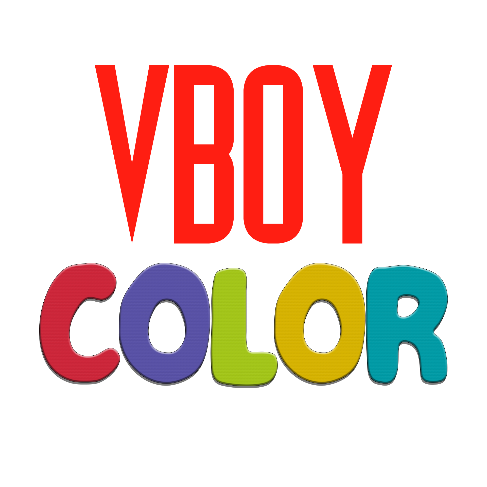
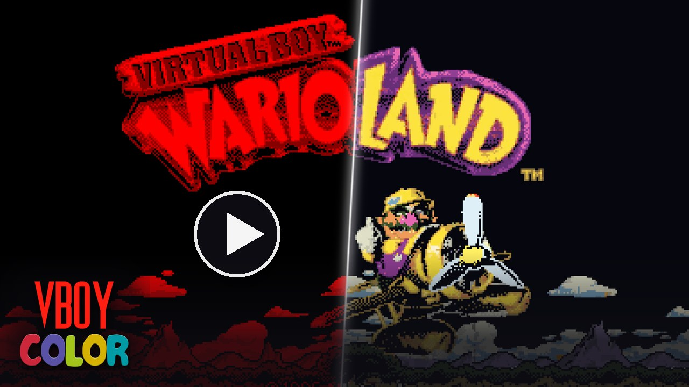
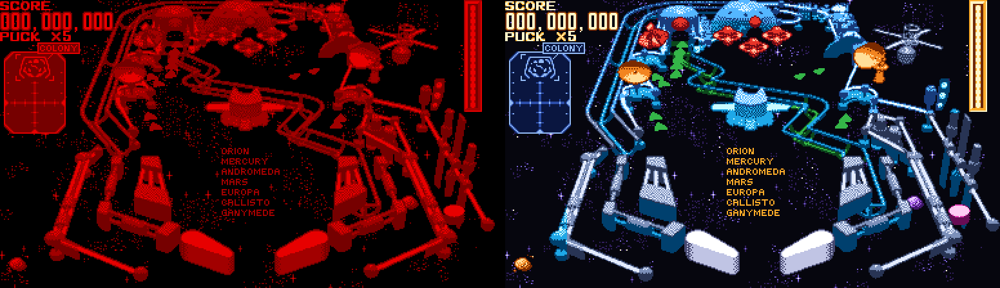
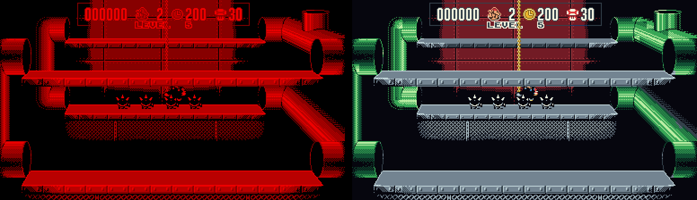
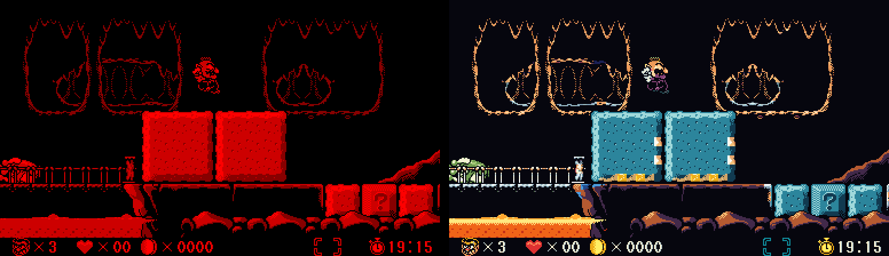
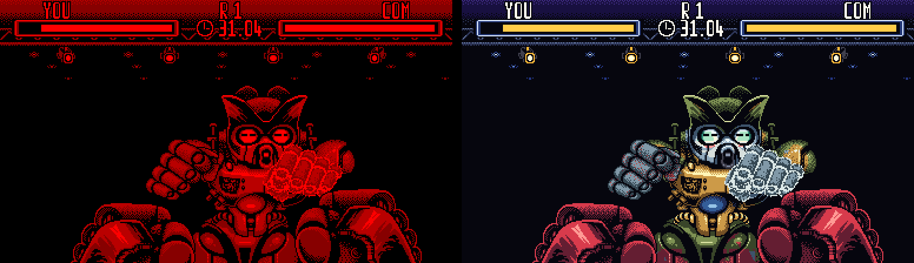
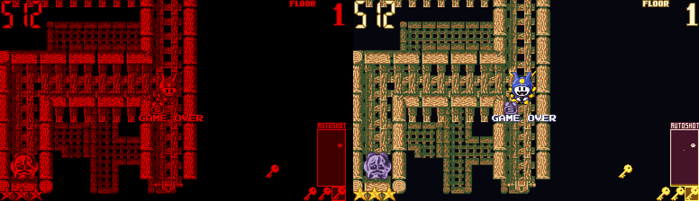
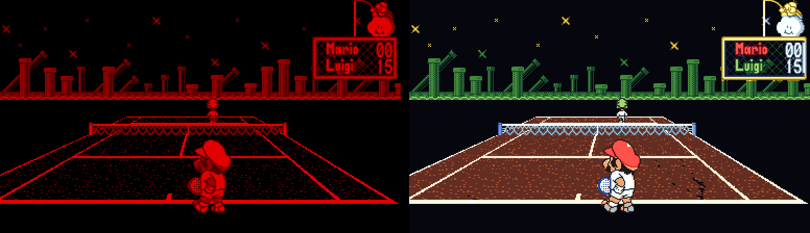

<h1 align="center"></h1>

<b>Virtual Boy games in color - in 3D on Meta Quest and Steam Frame, on PC, and on Android phones and handhelds.</b>

VBoy Color is a free, open-source Virtual Boy emulator. On a Quest or Frame
headset it shows games the way the Virtual Boy was meant to be seen, in
stereoscopic 3D, but in color instead of red on black. On Windows and Linux
it plays them in a window, no headset needed, and on Android phones, tablets
and handhelds with touch controls or a gamepad. It is also a RetroArch core,
for Windows, Linux, macOS, Android and the Nintendo Switch (homebrew).

 
<a href="https://youtu.be/vsScgEVnbME"><b>▶ Watch the demo</b></a> - eight games, the original red next to VBoy Color (2 min)

> VBoy Color is an independent fan project. It is not affiliated with,
> endorsed by, or sponsored by Nintendo or Meta. "Virtual Boy" is a trademark
> of Nintendo. No games are included - use only ROMs you made from cartridges
> you own.

*Left: the original. Right: VBoy Color (Auto mode with the game's color
pack).*

**Galactic Pinball** - the Colony table: bumpers, rails and targets each in their own color.

**Mario Clash** - green pipes, grey ledges and the brick wall behind them.

**Wario Land** - the cave in warm orange, the blocks in teal.

**Teleroboxer** - the robot in steel, gold and red.

**Jack Bros.** - Jack Frost in blue and white, his face touched up by hand to match the Virtual Boy's drawing.

**Mario's Tennis** - a clay court under a green skyline.

**3D with colored glasses** (Teleroboxer, PC and phones) - red / cyan on the left, amber / blue on the right; green / magenta too.

**3D side by side** (Vertical Force, PC and phones) - the left eye's picture next to the right eye's, for a 3D TV or parallel viewing; also squeezed for a 3D TV, cross-eyed, and top and bottom.

## Features

- **Color, four ways** (Settings → Color mode):
  - **Auto** (default) - every pixel is colored by what drew it: background
    layers by their depth (far to near: dusk violet, brick, amber, sand),
    characters by their palette, each with dark/light/lightest steps. What a
    game draws without tiles (Red Alarm's wireframe world, 3-D Tetris's
    well) is colored by how far away it is - the distance between the two
    eyes' pictures - from indigo far away to gold up close. Every game shows
    many colors with no setup.
  - **Multicolor** - each of the Virtual Boy's four shades gets its own color
    (in the spirit of Red Viper's multicolour mode), from a set of palettes.
  - **Gradient** - the game's brightness mapped onto a color gradient
    (Jade, Ocean, Sunset, Ember, Frost, Toxic).
  - **Tint** - the classic look: red, or any color you mix.
- **Color packs** - hand-painted colors for a game, tile by tile, shown in
  Auto and Multicolor modes. Packs for Bound High, Dragon Hopper, Galactic Pinball,
  Innsmouth no Yakata, Jack Bros., Mario Clash, Mario's Tennis, Panic Bomber, Space
  Invaders Virtual Collection, Teleroboxer, Vertical Force, V-Tetris and Wario
  Land are built in, plus the menus and HUD of Red Alarm and 3-D Tetris
  (their 3-D worlds are drawn without tiles, so Auto colors them by depth),
  Virtual Bowling's HUD, gauges and menus over its Sunset lanes, and Golf's
  menus and hole maps (its rounds are drawn without tiles too). Packs hold
  only colors, no game graphics. A `.vbcp` file next to a ROM overrides the
  built-in one, and you can paint your own on PC: see
  [docs/COLOR_PACKS.md](docs/COLOR_PACKS.md).
- **Colors per game** - every Virtual Boy game starts in the scheme that
  suits it best (picked game by game: Red Alarm's wireframes by depth,
  Golf's fairways green, Virtual Bowling's lanes in Sunset wood...),
  and remembers yours once you change it.
- **A library of your games** - each one a card with its box art,
  downloaded from libretro's thumbnail collection (keep playing while it
  comes). A game without box art, or with no internet, gets its title
  screen in its own colors instead, made on your device (nothing of any
  game ships with the app); Settings → Download box art off shows title
  screens for all. As a list (Y) or last played first (X), and all games
  or only those with a color pack (the chip at the top, or Settings → Only
  games with color packs). Pick with the
  sticks, a gamepad, the mouse, or by pointing a Quest or Frame controller
  and pulling its trigger.
- **Real 3D on Quest and Frame** - each eye gets its own
  picture, as on the hardware, and both eyes always show the same colors.
  On Quest the display runs at the headset's highest refresh rate, so
  scrolling stays smooth; on Frame, SteamVR picks the rate (set it
  per app in SteamVR's settings - 100 or 120 Hz).
- **Save states** - several slots per game, with thumbnails in color.
- **RetroAchievements** - log in with your
  [RetroAchievements](https://retroachievements.org) account (Achievements in
  the menu: an on-screen keyboard types your name and password - or a real
  keyboard on PC; Paste takes them from the clipboard, and the eye shows the
  password as you type it) and earn each game's achievements as you play. An unlock
  pops up over the game; the Achievements page lists the game's
  achievements with their badges, unlocked and still to get. Softcore: save
  states and everything else stay on (a save state keeps the achievements'
  progress too). Only the login token the site hands back is kept, in the
  settings folder - never your password. A game needs the ROM version
  RetroAchievements lists (the usual No-Intro dump).
- **Gamepads everywhere** - in the PC window, in PC VR and on Android, with
  the usual emulator layout (the Virtual Boy's A and B where they are on its
  controller: right and bottom); every pad connected works, and pads plugged
  in later are picked up.
- **Button mapping** - Quest and Frame controllers, gamepads and keyboard, all
  remappable - for all games, or per game (hold a game's card in the
  library).
- **Screen looks** - Settings → Screen → Look: *Sharp* pixels, *Smooth*
  (OmniScale's rounded edges and diagonals) or *LED* (the Virtual Boy's
  own rows of light, with a soft glow). Both eyes always get the same
  look, so the 3D stays clean.
- **Screen placement** - size and distance of the screen in VR; on PC,
  Settings → Screen → Size: as big as the window allows (*Fit*) or *Whole
  pixels*.
- **3D on a normal screen** (PC and phones) - Settings → Screen → 3D, then
  its format: *side by side* (3D TV - squeezed, as a TV's Side-by-Side mode
  expects -, full, or cross-eyed), *top and bottom* (3D TV or full), or
  *colored glasses* - *red / cyan*, *green / magenta* or *amber / blue*
  (mixed with Dubois' method, which keeps the games' colors as true as the
  glasses allow). Pictures of both at the top of this page.
- **Your room as the background** (Quest) - Settings → Adjust screen →
  Show your room around it: the game floats in your room (passthrough)
  instead of in the dark.
- **Updates** - VBoy Color looks for a new version when it starts (About →
  Check when VBoy Color starts): a notice pops up over the game or the menu
  when there is one, and the sidebar shows *Update available*; About →
  Update installs it. On PC the app replaces its own files
  (your games and saves stay) and restarts; on Android the system's
  installer takes the new APK (allow VBoy Color to install apps once; on the
  Quest it installs when the app next starts). A beta looks for betas too,
  a full release only for full releases.
- **Your own folders** - Settings → Folders: choose where your games,
  saved games, save states, settings and screenshots go (a synced folder,
  say). On PC
  you pick them right in the menu, with the mouse, a gamepad or in VR; on
  Android with the system's folder picker (on the Quest, when the app next
  starts). The files already there are copied over - newer ones win, the
  one replaced is kept as `.bak`, and the originals stay where they were.
- **Screenshots** - Save states → Screenshot (or F12 on PC) saves the
  game's picture, in its colors, as a PNG in the games folder's
  `screenshots` (Settings → Folders → Screenshots picks another).
- **Hotkeys** (PC) - Settings → Controls → Hotkeys: a key, or a key with
  Ctrl / Alt / Shift (Alt+F1, say), for the menu, fullscreen, screenshots,
  saving and loading a state, the save slot, reset, closing the game and
  quitting.
- **Video recording** (PC) - with Settings → Hotkeys → Color pack and video
  tools on, F12 records the original red and the colored version side by
  side, frame for frame, for comparison videos (F12 again to stop; it stops
  on its own after ten minutes).
- **Tool-assisted runs** (PC) - drop a Virtual Boy run from
  [TASVideos](https://tasvideos.org/Movies-VBoy) (a `.bk2` file) on the
  window, or open it with `VBoyColor.exe`: its game (from your `roms`
  folder) plays the whole run by itself, in color - F12 records it (with
  the video tools on, as above).
  Your own save stays untouched; when the run ends, you take over.

- **Support, and Yuno's Adventure** - Support in the menu's sidebar: if
  you'd like to gift me a coffee, the button there opens my Ko-fi page (a
  card or PayPal, no account needed). Under it, a little thank-you for stopping by: an endless runner in
  the Virtual Boy's reds, where my cat Yuno jumps rocks, bushes and gaps
  (A, Space, a click or a tap to jump; your best score is kept).

## Getting started

### Quest (Quest 2, 3, 3S, Pro)

1. Download `VBoyColor-<version>-quest-android-arm64.apk` from
   [Releases](https://github.com/yuk27/VBoyColor/releases).
2. Install it with [SideQuest](https://sidequestvr.com) or
   `adb install VBoyColor-<version>-quest-android-arm64.apk` (the headset must be in developer
   mode).
3. Copy your `.vb` ROMs to a folder on the headset (for example
   `Download/VBoyColor`). The color packs are built in.
4. Open VBoy Color from **Unknown Sources** in the app library and pick that
   folder when it asks.

**Smoother on Quest 3:** the Virtual Boy draws 50 frames a second, and Quest
3 can refresh at 100 Hz - two refreshes for every frame - but an app isn't
allowed to pick that rate itself. [Quest Games Optimizer](https://anagan79.itch.io/quest-games-optimizer)
can, or `adb shell setprop debug.oculus.refreshRate 100` (until the headset
restarts); VBoy Color then keeps it instead of asking for 120 Hz.

### Frame (Steam Frame)

1. Download `VBoyColor-<version>-linux-arm64.tar.gz` from
   [Releases](https://github.com/yuk27/VBoyColor/releases) and unpack it in
   your home folder on the Frame.
2. Put your `.vb` ROMs in its `roms` folder.
3. Run `./install-to-steam.py` in that folder: it adds VBoy Color to
   Steam with its icon and library artwork (Steam closes for a moment while
   it does). Start it from the library - started from Steam, SteamVR hands
   it the controllers.

The buttons are the Quest's - A and B, Y for Start, X for Select, Menu for
the menu - plus the D-pad as the left D-pad, the bumpers as L and R and View
as Select. SteamVR picks the refresh rate: set VBoyColorVR to 100 Hz (or
120 Hz) in its per-app settings for the smoothest scrolling. More in
[docs/STEAM_FRAME.md](docs/STEAM_FRAME.md).

### Android phones and tablets

The same `VBoyColor-<version>-quest-android-arm64.apk` works on phones, tablets
and Android handhelds (Android 10 or newer, 64-bit ARM, with Vulkan - nearly
every device from the last several years).
Install it, open VBoy Color and pick the folder with your `.vb` ROMs when it
asks. The game fills the screen's height, with the Virtual Boy controller
beside it: the left D-pad with Select and Start (and the menu button under
them), B and A with the right D-pad above them (only in the games that use
it - Red Alarm, Teleroboxer, 3-D Tetris and Golf), L and R on top. Settings →
Arrange touch controls lets you drag every control where you want it and
make it bigger or smaller (the buttons are Kenney's Input Prompts) - and a
game can have its own layout (hold its card in the library). Connect a
gamepad and the on-screen buttons step aside until you touch the screen
again - or switch them off in Settings → Touch controls: the game keeps the
whole screen, and they only show (over it) for a few seconds after you touch
it. Back opens the menu, and Back (or *Back to game*) returns to the
game. With no game loaded, the menu sits inside a Virtual Boy.

### Android TV and Fire TV

The same APK runs on Android TV boxes and Fire TV devices that run 64-bit
Android with Vulkan (many Fire TV sticks run 32-bit Android, which VBoy
Color doesn't support yet), played with a gamepad. To download it on the TV,
install the **Downloader** app (by AFTVnews) from the TV's app store, type
in the APK's link from [Releases](https://github.com/yuk27/VBoyColor/releases)
and allow Downloader to install apps when the TV asks. Pick the folder with
your `.vb` ROMs (a USB stick works) when VBoy Color asks. The gamepad opens
the menu with Select + Start held together (or Guide), and **Quit** at the
bottom of the menu's sidebar closes the app.

### Windows

Download `VBoyColor-<version>-windows-x64.zip` from
[Releases](https://github.com/yuk27/VBoyColor/releases), unzip it, put your
ROMs in the `roms` folder and run `VBoyColor.exe`. You can also drop a `.vb`
file on the window, or open one with `VBoyColor.exe`. `VBoyColorVR.exe` is the
VR version for a PC headset (Quest Link, Virtual Desktop or SteamVR).

### Linux

Download `VBoyColor-<version>-linux-x64.tar.gz`, unpack it, put your ROMs in
`roms` and run `./VBoyColor` from that folder. Needs a Vulkan driver.
`./VBoyColorVR` is the VR version, for a PC headset on SteamVR. For an ARM64
machine, download `VBoyColor-<version>-linux-arm64.tar.gz` instead.

### RetroArch

VBoy Color is also a RetroArch core (or for any other libretro frontend):
the same emulation and colors, with the 3D for a normal screen. Download
`vboycolor_libretro-<version>-<platform>.zip` for Windows, Linux (x86-64 or
ARM64), macOS, Android or the Nintendo Switch from
[Releases](https://github.com/yuk27/VBoyColor/releases), then:

1. Copy the core (`vboycolor_libretro.dll`, `.so` or `.dylib`) into
   RetroArch's cores folder (Settings → Directory → Cores shows where it is),
   and `vboycolor_libretro.info` into its core info folder (Settings →
   Directory → Core Info). Don't skip the `.info`: RetroArch's file browser
   only lists the file types that the installed cores' `.info` files name,
   so without it Load Content shows a folder's `.zip` files but hides its
   `.vb` games. On Android, use Load Core → Install or Restore a Core and
   pick `vboycolor_libretro_android.so`.
2. Load Core → **Nintendo - Virtual Boy (VBoy Color)**, then load a game.
3. Quick Menu → Core Options: **Colors** (the game's own, Auto,
   Multicolor, Gradient or Tint, and their palettes), **Color packs**, and
   **3D** - side by side (also cross-eyed or half width for a 3D TV), top and
   bottom, or red / cyan, green / magenta and amber / blue glasses.

The color packs are built in; a `.vbcp` file beside the ROM, with the ROM's
name, takes the place of its game's pack. RetroArch's save states, rewind,
run-ahead, shaders and RetroAchievements work as with any other core. On
macOS, if RetroArch won't load the core, clear the download's quarantine
first: `xattr -d com.apple.quarantine vboycolor_libretro.dylib`.

**Nintendo Switch** (homebrew, with RetroArch for the Switch): the Switch
can't load a core from a file, so the core comes as a RetroArch of its own,
`vboycolor_libretro_libnx.nro`. Copy the zip's `retroarch` folder onto the
SD card's root, merging it with the one there, then Load Core → **Nintendo -
Virtual Boy (VBoy Color)** (RetroArch restarts with it - normal on the
Switch). A Switch running Android or Linux uses the `android-arm64` or
`linux-arm64` core instead.

## Controls

**Menu:** the left controller's Menu button (the right one's on the Frame),
a gamepad's Select + Start held together (or Guide), or **Tab** or **Esc** on PC. Some PC VR runtimes
keep the Menu button for themselves - there, hold the left stick click for a
second. In the menu: sticks / D-pad / arrow keys move, A (Enter) picks, B
(Esc) goes back - out to the sidebar, or back to the game. The mouse and the
Quest and Frame controllers' lasers work too: a quick trigger press clicks, holding the
trigger and moving drags (scrolls lists and the library).

| Virtual Boy | Quest controllers | Frame controllers | Keyboard | Gamepad |
|---|---|---|---|---|
| Left D-pad | left stick | left stick or D-pad | arrow keys | D-pad or left stick |
| Right D-pad | right stick | right stick | W A S D | right stick |
| A / B | A / B | A / B | X / Z | B / A - where the Virtual Boy has them (right and bottom face buttons) |
| L / R | left / right trigger | left / right trigger or bumper | Q / E | LB / RB (or LT / RT) |
| Start / Select | Y / X | Y / X (or View for Select) | Enter / Backspace | Start / Back (View) |

The gamepad column is the PC window's and the phone's. With a gamepad in VR
(VBoyColorVR.exe, or a pad paired with the Quest), A is on A and B on B.
Everything can be remapped in Settings → Button mapping - and per game:
hold a game's card in the library (a finger or a Quest or Frame laser held still on
it; right-click with a mouse) for its own button mapping and, on a phone,
its own touch controls. On PC, **Alt+Enter** toggles fullscreen, and the
other keys are in Settings → Controls → Hotkeys: by default F2 saves a
state, F4 loads it, F6 / F7 pick the slot, F12 takes a screenshot, Ctrl+R
resets and Ctrl+Q quits. **Close game** (while one is running) and **Quit**
(on PC, and on Android phones and TVs) are at the bottom of the menu's
sidebar - press twice.

## Building

See [docs/BUILDING.md](docs/BUILDING.md) - the Windows and Linux apps, PC VR,
the Android app (Quest, phones and TVs) and the RetroArch core, all from one
CMake project. Every push is built by GitHub Actions.

## Support the project

Gift me a coffee on Ko-fi - a card or PayPal, no account needed:
https://ko-fi.com/yuk27

Or sponsor me on GitHub: https://github.com/sponsors/yuk27

## License

VBoy Color is free software under the **GNU General Public License v3.0**
(see [LICENSE](LICENSE)). The emulator core, Beetle VB, is GPL-2.0-or-later.
Other components and fonts are listed in
[THIRD-PARTY-NOTICES.md](THIRD-PARTY-NOTICES.md).

## Thanks

- **[VirtualBoyGo](https://github.com/CidVonHighwind/VirtualBoyGo)** by
  CidVonHighwind - VBoy Color started as a fork of its OpenXR + Vulkan
  rework. The VR app, renderer, menu, save states and button mapping come
  from there. Thank you for building it and sharing it.
- **[Beetle VB](https://github.com/libretro/beetle-vb-libretro)** - libretro's
  fork of Mednafen's Virtual Boy emulation, the emulator core. It is compiled
  untouched, apart from a generated hook in its video code that reports which
  tile drew each pixel (`cmake/PatchBeetleVip.cmake`).
- **[Red Viper](https://github.com/skyfloogle/red-viper)** - the Virtual Boy
  emulator for the 3DS, for the idea of coloring the four shades (its
  multicolour mode). No Red Viper code is used.
- **[RetroAchievements](https://retroachievements.org)** and its
  [rcheevos](https://github.com/RetroAchievements/rcheevos) library (MIT) -
  the achievements, made by its community for every Virtual Boy game it covers.
- **[Super Bit Shader](https://github.com/AshleyPikachu/Super-Bit-Shader)** by
  Ashley the Pikachu - RetroArch shaders that color the Virtual Boy, the Game
  Boy and the other monochrome handhelds, with side-by-side 3D for the
  Virtual Boy in VR. Thank you for keeping the colored Virtual Boy scene
  going with your great work. Super Bit Shader implementation is WIP.
- The libraries and fonts listed in
  [THIRD-PARTY-NOTICES.md](THIRD-PARTY-NOTICES.md).
